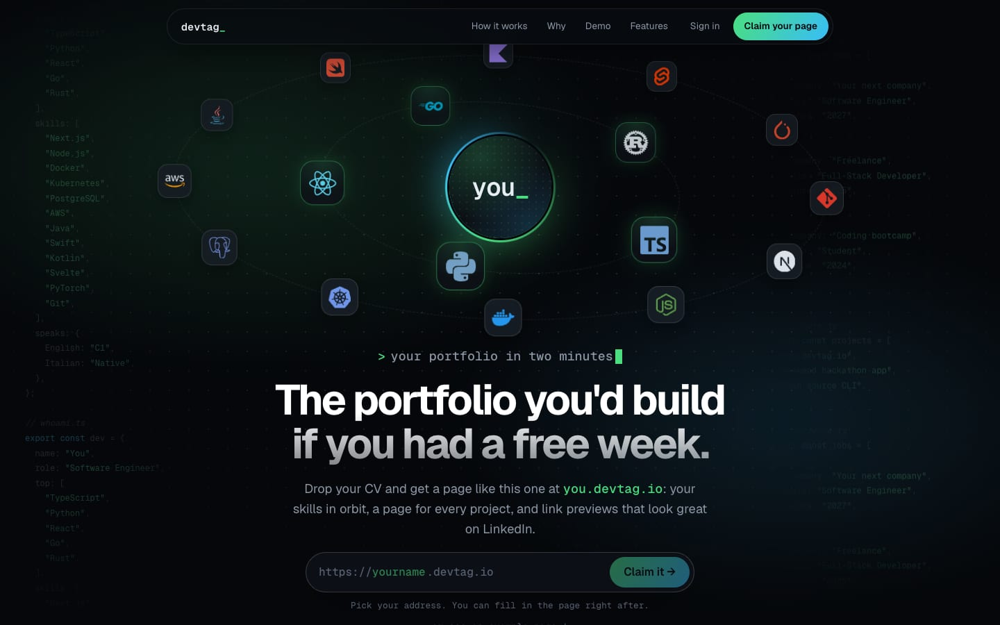
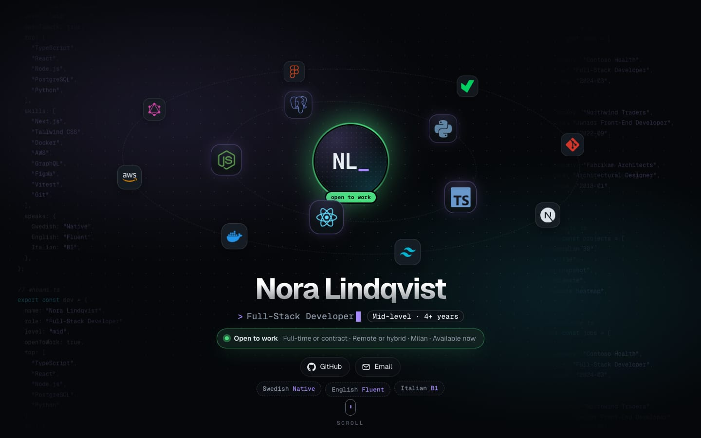
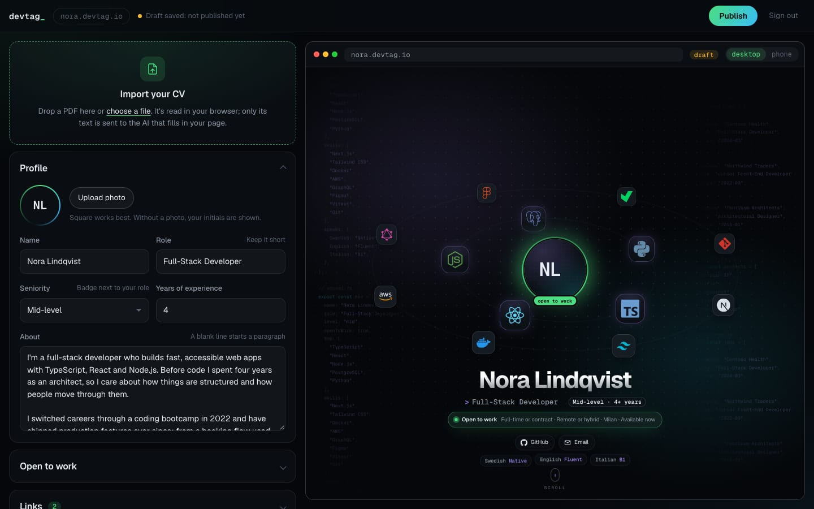

# devtag

**The portfolio you'd build if you had a free week.**

Developers drop their CV, review what it filled in, and publish a portfolio page at `yourname.devtag.io`: skills orbiting their photo, a page for every project, and link previews that look good on LinkedIn.

[](LICENSE)
[](https://nextjs.org)



| A published page                                  | The editor, with its live preview            |
| ------------------------------------------------- | -------------------------------------------- |
|  |  |

<sub>Nora Lindqvist is made up: she's the demo profile (`src/demo/config.ts`).</sub>

## Features

- **CV import.** The PDF is read in the browser, two-column layouts included. Only its text goes to an AI that fills in each section, and every imported section is marked "check" until you review it.
- **Skills in orbit.** Type `TypeScript`, `k8s` or `golang`: 3,500+ logos from Simple Icons and Devicon are found by name.
- **A page for every project,** with its own link and its own share image.
- **Link previews** (Open Graph) made from your page: photo, role, top skills.
- **Open to work and seniority:** a green ring on your photo, job types, work mode and availability, plus a "Senior · 6+ years" badge.
- **Your own subdomain** (`yourname.devtag.io`), with a path fallback (`/yourname`) where subdomains aren't set up.
- **An editor with a live preview** on desktop and phone sizes. Drafts save as you type; Publish makes them live.
- **Two theme colors** that every glow, gradient and preview image follows.
- **Fast and accessible:** rendered on the server, readable without JavaScript, calm for people who prefer reduced motion.

## How the CV import works

1. **In your browser:** [pdf.js](https://mozilla.github.io/pdf.js/) extracts the text with the position of each piece. A small column detector ([`src/lib/cv/columns.ts`](src/lib/cv/columns.ts)) puts two-column CVs in reading order and cleans up ligatures and icon-font symbols. The PDF never leaves your device.
2. **On the server:** the text is checked and cleaned again ([`src/lib/cv/input.ts`](src/lib/cv/input.ts)), then OpenAI turns it into the page's content, with the answer constrained to a strict JSON schema ([`src/lib/cv/ai.ts`](src/lib/cv/ai.ts)).
3. **Back in the editor:** whatever comes back is sanitized ([`src/lib/clean.ts`](src/lib/clean.ts)): known fields only, safe links only. You check each section before publishing.

Each account gets 3 imports a day, and the whole site 500, so the AI bill stays predictable.

## Tech stack

| Part      | What                                                                                               |
| --------- | -------------------------------------------------------------------------------------------------- |
| App       | [Next.js 16](https://nextjs.org) (App Router), React 19, TypeScript, CSS Modules                   |
| Login     | [Better Auth](https://www.better-auth.com), inside the app, with Google                            |
| Database  | [Neon](https://neon.com) Postgres                                                                  |
| Photos    | AWS S3 behind CloudFront. Every upload is re-encoded with [sharp](https://sharp.pixelplumbing.com) |
| CV import | [pdf.js](https://mozilla.github.io/pdf.js/) in the browser, OpenAI Structured Outputs              |
| Hosting   | [Vercel](https://vercel.com), with a wildcard domain for the subdomains                            |

## Run it locally

You need **Node.js 22+** and accounts with Neon, Google Cloud, AWS, and OpenAI (only for the CV import). All have free tiers, and S3 costs pennies.

```bash
git clone <this repo> devtag && cd devtag
npm install
cp .env.example .env.local   # fill it in: see below
npm run db:migrate           # creates the database tables (safe to run again)
npm run dev                  # http://localhost:3000
```

### Configuration (`.env.local`)

| Variable                                     | Where it comes from                                                                                                                              |
| -------------------------------------------- | ------------------------------------------------------------------------------------------------------------------------------------------------ |
| `BETTER_AUTH_SECRET`                         | Any random string: `openssl rand -base64 32`                                                                                                     |
| `BETTER_AUTH_URL`                            | The site's address: `http://localhost:3000` locally                                                                                              |
| `GOOGLE_CLIENT_ID`, `GOOGLE_CLIENT_SECRET`   | Google Cloud → Google Auth Platform → Clients → a **Web application** client, with redirect URI `http://localhost:3000/api/auth/callback/google` |
| `DATABASE_URL`, `DATABASE_URL_UNPOOLED`      | Neon → Connect: the pooled string (with `-pooler`), and the direct one (pooling off), used by migrations                                         |
| `AWS_REGION`, `S3_BUCKET`                    | A **private** S3 bucket (Block all public access: on)                                                                                            |
| `PHOTOS_URL`                                 | A CloudFront distribution on that bucket, with Origin Access Control: `https://xxxx.cloudfront.net`                                              |
| `AWS_ACCESS_KEY_ID`, `AWS_SECRET_ACCESS_KEY` | An IAM user allowed only `s3:PutObject` and `s3:DeleteObject` on `arn:aws:s3:::<bucket>/photos/*`                                                |
| `OPENAI_API_KEY`, `OPENAI_MODEL`             | Optional: the CV import says it isn't set up without a key. The model defaults to `gpt-6-luna`                                                   |
| `NEXT_PUBLIC_ROOT_DOMAIN`                    | Optional: `devtag.io` turns on subdomains. Leave it empty for `/yourname` paths, or use `localhost:3000` to try `yourname.localhost:3000`        |

While your Google app is in "Testing", only the test users you add in Google Cloud can sign in.

### Scripts

| Command              | What it does                                                                               |
| -------------------- | ------------------------------------------------------------------------------------------ |
| `npm run dev`        | Development server on http://localhost:3000                                                |
| `npm run build`      | Production build (`npm start` serves it)                                                   |
| `npm test`           | The tests: CV reading and column detection, input checks, config cleanup, photo processing |
| `npm run db:migrate` | Creates or updates the tables: Better Auth's, plus [`db/schema.sql`](db/schema.sql)        |

## Project structure

```
src/
  app/                    pages and API routes
    [username]/           a published page, its project pages and share images
    admin/                the editor and its preview
    api/                  CV import, photo upload, saving and publishing, login (auth/)
    login/, welcome/      sign-in with Google, then picking your address
  components/
    profile/              the portfolio template every page is built from
    admin/                the editor
    landing/              landing page pieces
  lib/                    config types and cleanup, data store, login, icons, CV reader (cv/), photos
  demo/                   the demo profile
  proxy.ts                serves yourname.devtag.io from the /yourname routes
db/schema.sql             devtag's tables
scripts/                  database migration, and copying assets from node_modules
test/                     tests, and CVs to test against (made-up people)
```

## Deploy on Vercel

1. Import the repository in Vercel, and set the functions' region next to your database (e.g. `fra1` for Neon in Frankfurt).
2. Add the environment variables, with `BETTER_AUTH_URL` set to your domain. For S3, prefer [Vercel's OIDC federation](https://vercel.com/docs/oidc/aws) with `AWS_ROLE_ARN` over long-lived access keys.
3. **Subdomains:** add your domain and its wildcard (`*.yourdomain`) in Vercel, which needs the domain's DNS on Vercel. Then set `NEXT_PUBLIC_ROOT_DOMAIN`.
4. **Google:** add your domain as an authorized origin, and `https://yourdomain/api/auth/callback/google` as a redirect URI. Publish the app when you're ready for everyone to sign in.

## Contributing

Issues and pull requests are welcome. Before opening a PR, run `npm test` and `npm run build`. Code is formatted with Prettier (`.prettierrc`).

## Security

Please don't open public issues for vulnerabilities. Report them privately through GitHub's **Security → Report a vulnerability**.

## License

Copyright © 2026 Andrea Borghesi.

devtag is free software under the [GNU Affero General Public License v3.0](LICENSE): you can use, study, change and share it. If you run a modified version as a service for others, you must publish your changes under the same license.

**The name "devtag" and its logo are not covered by the license.** If you run your own copy, please give it a different name.

## Credits

- Logos: [Simple Icons](https://simpleicons.org) (CC0-1.0) and [Devicon](https://devicon.dev) (MIT). Brand logos belong to their owners.
- [pdf.js](https://github.com/mozilla/pdf.js) (Apache-2.0), [sharp](https://github.com/lovell/sharp) (Apache-2.0), [Better Auth](https://github.com/better-auth/better-auth) (MIT).
- [Geist](https://vercel.com/font) fonts (SIL Open Font License 1.1).
